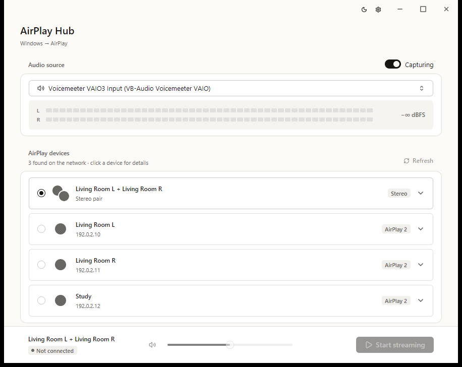
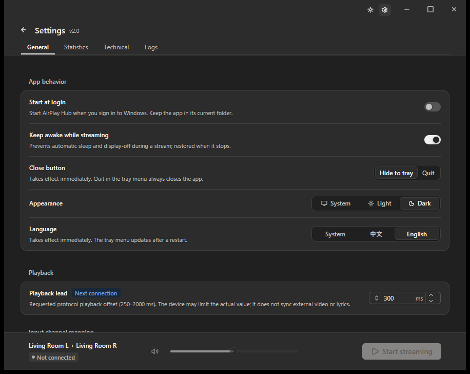

<div align="center">

# AirPlay Hub

**English** · [简体中文](README.zh-CN.md)

**Send the sound on your Windows PC to HomePod.**

Pick any recording device, or the output a device is already playing, and stream it over AirPlay 2 to a HomePod, a HomePod stereo pair or another receiver.


[Quick start](#-quick-start) · [Features](#-features) · [Technical route](#-technical-route-and-choices) · [Docs](#-documentation) · [Changelog](CHANGELOG.md)

</div>

<table>
  <tr>
    <td width="50%"></td>
    <td width="50%"></td>
  </tr>
  <tr>
    <td align="center">Playback · light</td>
    <td align="center">Settings · dark</td>
  </tr>
</table>

> [!NOTE]
> This branch prepares the **2.0.0 release candidate**: the desktop UI is rebuilt on GPUI and the Ely component library, and the unpublished 1.1.0 release candidate is folded into it. v1.0.3 is the reference for upgrades and rollback. Test coverage and the remaining hardware checks are in the [migration checklist](docs/gpui-migration-checklist.md) (Chinese). The devices in the screenshots are made up.

## ✨ Features

**Audio**

- WASAPI recording and Playback loopback capture with live left / right levels.
- Resampling to 44100 Hz, 16-bit PCM, ALAC framing and encrypted transport.
- Adjustable playback lead, buffer and long-term clock drift correction.

**Devices**

- Automatic discovery on the local network, passwords only when asked, single receivers and HomePod stereo pairs.
- Left / right input mapping, speaker swapping, and volume kept in sync with the HomePod's own buttons.

**Desktop**

- A native window with no WebView; light and dark follow the system, and the window resizes freely.
- Chinese and English, following the Windows display language by default; the installer's language carries into the app.
- Smooth scrolling, elastic edges and page transitions, switched off when Windows asks for reduced motion.
- Tray icon, single instance and start at sign-in.

**Power and stability**

- Keeps the system and display awake only while streaming, then restores your sleep settings.
- While idle, hiding the window to the tray, minimising it or a sleeping display releases the audio device; capture resumes when the window is seen again.
- Searching for devices no longer locks the window; source and settings stay usable.
- Runtime statistics, technical details, redacted logs and per-packet diagnostics.

## 🚀 Quick start

### Installer

Quit the running app from the tray first, then run the installer. An existing Inno Setup installation upgrades in place and keeps its folder and settings; do not uninstall first.

### Portable

Unpack the whole folder to a writable place on Windows x64 and start `airplay-bridge.exe`, keeping the backend and DLLs in `runtime/`. Portable data lives in `data/` next to the program; the installed app uses `%APPDATA%\AirPlay Hub`.

### Build from source

You need Git, Rust MSVC (1.98 or later), the Visual Studio C++ Build Tools / Windows SDK, MSYS2 UCRT64 and Python. The native backend applies reviewed patches to a temporary copy of the pinned submodule sources before compiling; see the [build guide](docs/building.md) (Chinese).

```powershell
# Fetch the pinned third-party sources; only what this project needs
git submodule update --init -- upstream/airplay-cli
git -C upstream/airplay-cli submodule update --init -- libraop
git -C upstream/airplay-cli/libraop submodule update --init -- crosstools

# Build the native backend, the diagnostic CLI and the 2.0 UI into dist/
.\scripts\build-desktop.ps1 -Release

# Build and package releases/v2.0 (installer, portable ZIP, SHA256SUMS)
.\scripts\package-release.ps1
```

Add `-Offline` once dependencies are downloaded. At run time keep the backend and DLLs that live in `dist/`.

## 🎧 Using it

1. Under **Audio source**, choose a recording or playback device; the level meters start moving.
2. Under **AirPlay devices**, choose a receiver or a stereo pair, then click **Start streaming** at the bottom.
3. If the receiver asks for a password, a field appears above the bottom bar. The password is used for this connection only and never saved.

Stereo pairs must be made in Apple's Home app first. The gear at the top right opens settings: General, Statistics, Technical and Logs. Closing the window hides it to the tray by default; choose **Quit** from the tray menu to exit. The full guide is in [UI and settings](docs/ui.md) (Chinese).

## 🧭 Technical route and choices

| Version | UI | Highlights |
|---|---|---|
| 1.0.x | Vue 3 + Tauri 2 WebView | Needs WebView2; the UI calls the Rust backend over IPC |
| 1.1.0 candidate (unpublished) | GPUI `0.2.2` + gpui-component | No WebView; the UI calls the desktop services in-process |
| **2.0.0 candidate** | **GPUI `gpui-pre 0.3.11` + Ely GPUI Components** | A rebuilt UI and interaction on the same service layer |

- **Why GPUI**: no WebView2; the UI and the Rust desktop services share a process with typed calls; the build needs only Rust and the native-backend toolchain.
- **Why Ely**: consistent theme tokens, light and dark, complete form and layout components, a window shell and motion parts that respect reduced motion; MIT licensed.
- **Why a separate crate**: Ely's `gpui-pre` is type-incompatible with `gpui 0.2.2`, so the 2.0 UI lives in `airplay-frontend/src-ely` and shares the gpui-free session, event and diagnostics modules with the 1.1 UI. Ely is pinned at commit `69a62b1`.
- **Built in-house**: 8 px-grid grouped cards, smooth and elastic scrolling, a source picker that scrolls smoothly, window-visibility detection, and paired Chinese / English strings.
- **Service changes to match**: keep awake only while streaming; discovery excludes only starting a stream.

Reasons, constraints, trade-offs and to-dos are in [Technical route](docs/tech-stack.md).

## 🏗️ Architecture

```text
GPUI native window (gpui-pre + Ely components)
        ↓ Rust desktop services and bounded events
Rust desktop management and audio core
  WASAPI capture → channel mapping → rubato resampling → 16-bit PCM
        ↓ bounded queues and a process pipe
C/C++ native backend
  authentication and control session → ALAC framing → encrypted RTP, clock and retransmission
        ↓ local network
AirPlay receiver
```

The UI calls the Rust libraries in `airplay-core/` through `airplay-desktop/`; the protocol backend is the separate `airplay-backend.exe`. `homepod-test.exe` is a diagnostic tool built on the same core, and Python is used only at build time to generate the upstream adaptation. Modules and lifecycles are in [Architecture](docs/architecture.md) (Chinese).

## 📁 Repository layout

```text
├── airplay-frontend/  Desktop UIs: src-ely (2.0), src-gpui (1.1 candidate), legacy Vue/Tauri reference
├── airplay-desktop/   Windows desktop services: settings, capture source, sessions, auth, keep-awake
├── airplay-core/      Shared Rust audio library and diagnostic CLI
├── airplay-backend/   C/C++ AirPlay backend and Windows adaptation
├── test/              Tests and synthetic fixtures by frontend / backend / core
├── upstream/          Third-party submodules (URL and pinned commit only)
├── scripts/           Build and packaging scripts
├── docs/              Usage, build, architecture, technical route and troubleshooting
├── .github/           Issue and PR templates
├── CONTRIBUTING.md    Development and contribution conventions
├── LICENSE            Full Apache-2.0 text
├── NOTICE             Project copyright and third-party attribution
└── THIRD_PARTY.md     Third-party sources and licences
```

`build/`, `dist/`, `releases/`, `target/`, `node_modules/`, `test/.artifacts/` and `.local/` hold local output or personal material and are not committed. `.local/` keeps earlier environment trials and backups; do not delete it as a cache. Test folders and entry points are in the [test guide](test/README.md) (Chinese).

Third-party sources are referenced through `.gitmodules` at pinned commits; GitHub's automatic source ZIP does not include submodule contents.

## 📚 Documentation

Most documents are in Chinese; the README and the technical route have English versions.

| Using | Developing | Releases and licences |
|---|---|---|
| [UI and settings](docs/ui.md) | [Technical route](docs/tech-stack.md) | [Changelog](CHANGELOG.md) |
| [CLI diagnostics](docs/cli.md) | [Architecture](docs/architecture.md) | [Third-party sources](THIRD_PARTY.md) |
| [Error codes](docs/error-codes.md) | [Build guide](docs/building.md) | [Licence status](docs/licensing.md) |
| [Display-off capture](docs/display-off-capture.md) | [Test guide](test/README.md) | [Contributing](CONTRIBUTING.md) |
| [Log retention](docs/log-retention.md) | [Migration checklist](docs/gpui-migration-checklist.md) | [Docs index](docs/README.md) |

## 🔒 Data and privacy

- GUI settings and logs live in `%APPDATA%\AirPlay Hub`; the CLI's device list, logs and recording diagnostics live in its `cli` subfolder.
- Passwords are never stored and never passed as process arguments.
- Logs hide device names, IP addresses, user folders, public keys, MAC addresses and UUIDs by default and filter passwords, tokens and credentials, keeping formats, timing and counts. Devices are linked by an index within the current list, not a permanent UUID.
- Older logs are not rewritten, so check them before sharing. Per-packet diagnostics never store raw audio; the four-segment rotation applies only to that diagnostic file.

Retention is described in [Log retention](docs/log-retention.md) and synthetic measurements in [Performance baseline](docs/performance-baseline.md) (both Chinese).

## ⚠️ Current limits

- Windows only; the send format is fixed at 44100 Hz, 16-bit, stereo.
- Stereo targets existing HomePod stereo pairs; general multi-room grouping is not implemented.
- A virtual playback endpoint occasionally yields silent or torn audio on first open; the cause is still under investigation.
- The latency estimate excludes the time apps and speakers take to produce sound, and does not sync lyrics or video in other players.
- Errors returned by the service layer and the native backend are in Chinese only.
- Builds, simulated checks and successful sends do not replace playback checks on real receivers.

## 🗺️ Roadmap

- [x] Switch packaging to the 2.0 UI.
- [ ] Release 2.0 after hardware checks.
- [ ] Per-app capture: stream the audio of one application.
- [ ] Multi-device groups: play to several AirPlay receivers in sync.

## 🤖 AI-assisted development

This project is developed with help from OpenAI Codex and Anthropic Claude. AI took part in architecture discussions, writing and changing code, UI design, problem analysis and documentation; the maintainer owns the requirements and direction, development decisions, testing on real devices and release management. The project does not claim that all code was written by hand by the maintainer.

The AirPlay protocol basis and some components come from third-party open-source projects; their attribution and licences are in [THIRD_PARTY.md](THIRD_PARTY.md). AI assistance does not change those notices. Generated code may still contain defects; what has actually been verified and the current limits are stated above.

## 🙏 Third-party code and thanks

The protocol backend is based on Music Assistant's airplay-cli and uses libraop's bplist reader / writer and crosstools' interface declarations. Audio resampling uses rubato; the UI uses GPUI and Ely GPUI Components (the 1.1 candidate uses GPUI Component) and ships the Inter, JetBrains Mono and IBM Plex Sans fonts and Lucide icons.

Third-party code belongs to its authors; this project provides the Windows adaptation, the desktop app and the audio pipeline. Pinned versions, files used, local changes, package dependencies and protocol references are in [THIRD_PARTY.md](THIRD_PARTY.md). Referencing submodules does not change third-party licence terms.

## 📄 License

The project's own code and documentation are licensed under the **Apache License 2.0**; see [LICENSE](LICENSE) for the full terms and [NOTICE](NOTICE) for attribution. Unless stated otherwise it covers the project's original contributions and licensable local changes, and does not replace third-party licences.

Apache-2.0 allows commercial use, modification and distribution without a separate commercial licence from this project, provided you keep the licence and notices and mark changes; the software is provided as is, without warranty. Third-party components keep their own licences.

One item is still open: the licensing basis of `bplist.cpp` / `bplist.h` in the pinned libraop version. That historical commit lacks the licence it refers to; upstream now carries an MIT notice, but whether it covers the version used still needs confirming. The dependency notices for release packages are also not yet complete. See [Licence status](docs/licensing.md) (Chinese).

## 💬 Contributing and feedback

When reporting a problem or proposing a change, include the steps to reproduce, the expected and actual behaviour, the versions involved and what you verified. Remove personal device names, addresses, endpoints and paths before sharing logs. Conventions and checks are in [Contributing](CONTRIBUTING.md) (Chinese).
