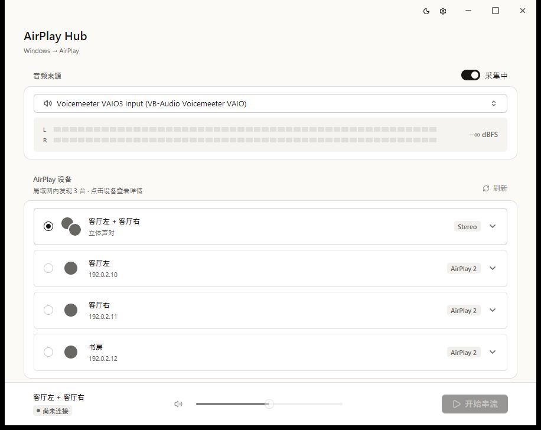
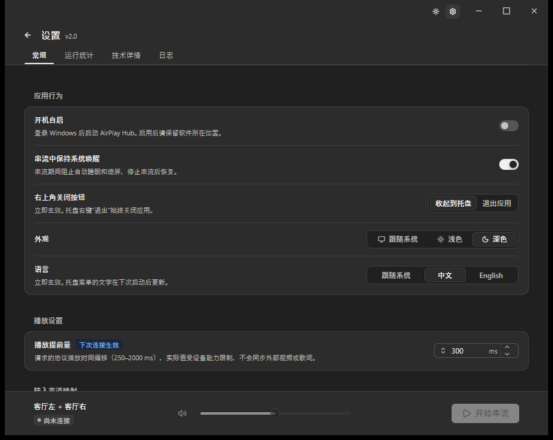

<div align="center">

# AirPlay Hub

[English](README.md) · **简体中文**

**把 Windows 上的声音送到 AirPlay 设备。**

选择任意录音设备或正在播放的输出设备，通过 AirPlay 2 发送到 HomePod、HomePod 立体声对等接收端。

<p align="center">
  <a href="https://github.com/albzO/Airplay_Bridge/releases/latest"></a>
  <a href="https://github.com/albzO/Airplay_Bridge/releases/latest"></a>
  <a href="https://github.com/albzO/Airplay_Bridge/releases/latest"></a>
  <a href="LICENSE"></a>
  
  
  
</p>

[快速开始](#-快速开始) · [功能](#-功能) · [技术路线](#-技术路线与技术选择) · [文档](#-文档) · [更新日志](CHANGELOG.md)

</div>

<table>
  <tr>
    <td width="50%"></td>
    <td width="50%"></td>
  </tr>
  <tr>
    <td align="center">播放页 · 浅色</td>
    <td align="center">设置 · 深色</td>
  </tr>
</table>

> [!NOTE]
> **2.0** 桌面界面基于 GPUI 与 Ely 组件库重做，未发布的 1.1.0 发行候选并入本版本。从 v1.0.3 升级会保留设置与数据。测试范围与实机验收见 [迁移清单](docs/gpui-migration-checklist.md)。截图中的设备为虚构示例。

## ✨ 功能

**音频**

- WASAPI 录音与 Playback loopback 采集，实时左右电平。
- 44100 Hz 重采样、16-bit PCM 量化、ALAC 帧封装与加密传输。
- 可调播放提前量、Buffer 与长期时钟漂移校正。

**设备**

- 局域网自动发现，按需密码认证，单设备与 HomePod 立体声对。
- 左右输入映射、扬声器位置交换，音量与 HomePod 按钮双向同步。

**桌面体验**

- 原生窗口，无需 WebView；浅色 / 深色跟随系统，窗口可自由缩放。
- 中英双语，默认跟随 Windows 显示语言，安装时所选语言会带入应用。
- 平滑滚动、弹性边界与页面过渡；Windows 开启“减少动画”时自动关闭。
- 托盘常驻、单实例、开机自启。

**省电与稳定**

- 只在串流时保持系统与屏幕唤醒，停止后恢复原有睡眠设置。
- 未串流时，窗口收进托盘、最小化或熄屏即释放音频设备，恢复可见后自动重新采集。
- 搜索设备时不锁住界面，来源与设置照常可用。
- 运行统计、技术详情、脱敏日志与逐包诊断。

## 🚀 快速开始

### 安装包

先从托盘退出正在运行的应用，再运行安装程序。现有 Inno Setup 安装版可直接升级，沿用原目录并保留配置，不要先卸载。

### 便携包

在 Windows x64 上把完整目录解压到可写位置，启动 `airplay-bridge.exe`，保留 `runtime/` 中的后端和 DLL。便携版数据位于程序目录的 `data/`，安装版位于 `%APPDATA%\AirPlay Hub`。

### 从源码构建

需要 Git、Rust MSVC（1.98 及以上）、Visual Studio C++ Build Tools / Windows SDK、MSYS2 UCRT64 和 Python。原生后端在固定子模块源码的临时副本上应用已审查的补丁后编译，详见 [构建指南](docs/building.md)。

```powershell
# 获取固定版本的第三方源码；只初始化本项目所需依赖
git submodule update --init -- upstream/airplay-cli
git -C upstream/airplay-cli submodule update --init -- libraop
git -C upstream/airplay-cli/libraop submodule update --init -- crosstools

# 构建原生后端、诊断 CLI 与 2.0 界面，输出到 dist/
.\scripts\build-desktop.ps1 -Release

# 构建并打包到 releases/v2.0（安装包、便携 ZIP、SHA256SUMS）
.\scripts\package-release.ps1
```

依赖下载完成后可加 `-Offline` 离线构建。运行时保留整个 `dist/` 目录中的后端与 DLL。

## 🎧 使用

1. 在“音频来源”中选择录音设备或播放设备，电平条开始跳动。
2. 在“AirPlay 设备”中选择接收端或立体声对，点击底部的 **开始串流**。
3. 接收端要求密码时，底部栏上方会弹出输入框；密码只用于本次连接，不会保存。

立体声对需先在 Apple 家庭 App 中组成。点击右上角齿轮进入设置，查看常规、运行统计、技术详情和日志。默认关闭窗口收进托盘，托盘右键“退出”关闭应用。完整说明见 [界面与设置](docs/ui.md)。

## 🧭 技术路线与技术选择

| 版本 | 界面 | 要点 |
|---|---|---|
| 1.0.x | Vue 3 + Tauri 2 WebView | 依赖 WebView2，界面经 IPC 调用 Rust 后台 |
| 1.1.0 候选（未发布） | GPUI `0.2.2` + gpui-component | 去掉 WebView，界面与桌面服务同进程直接调用 |
| **2.0.0 候选** | **GPUI `gpui-pre 0.3.11` + Ely GPUI Components** | 在同一服务层上重做界面与交互 |

- **为什么是 GPUI**：不依赖 WebView2；界面与 Rust 桌面服务同进程、强类型调用；构建只需 Rust 与原生后端工具链。
- **为什么是 Ely**：统一的主题令牌、浅色 / 深色、完整的表单与布局组件、窗口外壳和动效部件，并尊重系统的“减少动画”设置；MIT 许可。
- **为什么是独立 crate**：Ely 依赖的 `gpui-pre` 与 `gpui 0.2.2` 类型不兼容，2.0 界面放在 `airplay-frontend/src-ely`，与 1.1 界面共用不依赖 gpui 的会话、事件和诊断模块源码。Ely 固定在提交 `69a62b1`。
- **自行实现的部分**：8 px 网格分组卡片、平滑与弹性滚动、可平滑滚动的来源下拉、窗口可见性检测、成对书写的中英文案。
- **服务层的配套调整**：保持唤醒只在串流中生效；发现设备只与开始串流互斥。

完整原因、约束、取舍与待办见 [技术路线](docs/tech-stack.zh-CN.md)。

## 🏗️ 架构

```text
GPUI 原生窗口（gpui-pre + Ely 组件库）
        ↓ Rust 桌面服务与有界事件
Rust 桌面管理与音频核心
  WASAPI 采集 → 声道映射 → rubato 重采样 → 16-bit PCM
        ↓ 有界队列和进程管道
C/C++ 原生后端
  认证与控制会话 → ALAC 帧封装 → 加密 RTP、时钟与重传
        ↓ 局域网
AirPlay 接收端
```

界面通过 `airplay-desktop/` 调用 `airplay-core/` 中的 Rust 库，协议后端为独立的 `airplay-backend.exe`。`homepod-test.exe` 是使用同一核心模块的诊断工具，Python 只在构建阶段生成上游适配源码。模块与生命周期见 [架构文档](docs/architecture.md)。

## 📁 仓库结构

```text
├── airplay-frontend/  桌面界面（src-ely：GPUI + Ely）
├── airplay-desktop/   Windows 桌面服务：配置、采集源、会话、认证、唤醒
├── airplay-core/      共用 Rust 音频库及诊断 CLI
├── airplay-backend/   C/C++ AirPlay 后端与 Windows 适配
├── test/              按 frontend / backend / core 分类的测试与合成素材
├── upstream/          第三方子模块（仅提交地址与固定版本引用）
├── scripts/           构建与打包脚本
├── docs/              使用、构建、架构、技术路线与排查文档
├── .github/           问题与 PR 模板
├── CONTRIBUTING.md    开发与贡献约定
├── LICENSE            Apache-2.0 完整许可文本
├── NOTICE             项目版权及第三方归属说明
└── THIRD_PARTY.md     第三方来源和许可证记录
```

`build/`、`dist/`、`releases/`、`target/`、`node_modules/`、`test/.artifacts/` 和 `.local/` 是本地生成或个人资料目录，不提交 Git。`.local/` 中保存旧环境练习和备份，不能当作临时缓存整体删除。测试目录和运行入口见 [测试说明](test/README.md)。

第三方源码通过 `.gitmodules` 以固定提交引用，GitHub 自动生成的源码 ZIP 不包含子模块内容。

## 📚 文档

| 使用 | 开发 | 发行与授权 |
|---|---|---|
| [界面与设置](docs/ui.md) | [技术路线](docs/tech-stack.zh-CN.md) | [更新日志](CHANGELOG.md) |
| [CLI 诊断](docs/cli.md) | [架构](docs/architecture.md) | [第三方依赖与来源](THIRD_PARTY.md) |
| [错误代码](docs/error-codes.md) | [构建指南](docs/building.md) | [许可证状态](docs/licensing.md) |
| [自动熄屏采集故障](docs/display-off-capture.md) | [测试说明](test/README.md) | [贡献指南](CONTRIBUTING.md) |
| [日志保留限制](docs/log-retention.md) | [迁移清单](docs/gpui-migration-checklist.md) | [文档导航](docs/README.md) |

## 🔒 运行数据与隐私

- GUI 配置与日志位于 `%APPDATA%\AirPlay Hub`；CLI 设备清单、日志和录音诊断位于其 `cli` 子目录。
- 密码不持久保存，也不作为进程参数传递。
- 日志默认隐藏设备名称、IP、用户目录、公钥、MAC 和 UUID，并过滤密码、令牌及凭据字段，保留格式、时序与统计。设备以本次清单内的编号关联，不使用永久 UUID。
- 历史日志不会自动改写，分享旧日志前仍需检查。逐包诊断不保存原始音频；四段滚动限制只适用于该诊断文件。

日志的保留范围见 [日志限制](docs/log-retention.md)，合成测量见 [性能基线](docs/performance-baseline.md)。

## ⚠️ 当前限制

- 仅支持 Windows；发送格式固定为 44100 Hz、16-bit、双声道。
- 立体声面向已有的 HomePod 立体声对，尚未实现通用多房间组网。
- 虚拟播放端点首次打开偶尔出现全零片段与撕裂，原因仍在排查。
- 延迟估计不包含应用和扬声器实际发声耗时，不会同步外部播放器的歌词或视频。
- 服务层与原生后端返回的错误信息目前只有中文。
- 编译、模拟检查及发送成功不能代替真实接收端的播放验证。

## 🗺️ 路线图

- [x] 打包入口切换到 2.0 界面。
- [ ] 完成实机验收后发布 2.0。
- [ ] 软件捕获：只采集指定应用的音频。
- [ ] 多设备编组：多个 AirPlay 接收端同步播放。

## 🤖 AI 辅助开发声明

本项目在 OpenAI Codex 与 Anthropic Claude 的协助下开发。AI 参与了架构方案讨论、代码生成与修改、界面设计、问题分析和文档编写；项目维护者负责需求与功能方向、开发决策、真实设备测试和发布管理。本项目不声称全部代码由维护者独立手写。

AirPlay 协议基础及部分组件来自第三方开源项目，其归属和许可证见 [THIRD_PARTY.md](THIRD_PARTY.md)。AI 辅助开发不改变这些第三方声明。生成的代码仍可能存在缺陷，实际验证范围与当前限制见上文。

## 🙏 第三方代码与致谢

协议后端基于 Music Assistant airplay-cli，使用 libraop 的 bplist 读写及 crosstools 的接口声明。Rust 音频处理使用 rubato；界面使用 GPUI 与 Ely GPUI Components，随附 Inter、JetBrains Mono、IBM Plex Sans 字体与 Lucide 图标。

感谢以下项目：

| 项目 | 用途 |
| --- | --- |
| [Music Assistant airplay-cli](https://github.com/music-assistant/airplay-cli) | AirPlay 2 协议后端 |
| [libraop](https://github.com/philippe44/libraop) | 二进制 plist 读写 |
| [crosstools](https://github.com/philippe44/crosstools) | 平台与日志接口声明 |
| [GPUI (Zed)](https://github.com/zed-industries/zed) | 窗口、渲染与平台层 |
| [Ely GPUI Components](https://github.com/ELY-Open-Source/Ely-GPUI-Components) | 主题、组件与动效 |
| [rubato](https://github.com/HEnquist/rubato) | sinc 重采样 |
| [mdns-sd](https://github.com/keepsimple1/mdns-sd) | mDNS 设备发现 |
| [windows-rs](https://github.com/microsoft/windows-rs) | WASAPI 与 Windows API 绑定 |
| [tray-icon](https://github.com/tauri-apps/tray-icon) | Windows 托盘图标 |
| [Lucide](https://github.com/lucide-icons/lucide) | 图标 |
| [Inter](https://github.com/rsms/inter) | 界面字体 |
| [JetBrains Mono](https://github.com/JetBrains/JetBrainsMono) | 等宽字体 |
| [IBM Plex](https://github.com/IBM/plex) | 界面字体 |
| [pyatv](https://github.com/postlund/pyatv) | 配对与事件通道的协议参考 |
| [Shairport Sync](https://github.com/mikebrady/shairport-sync) | 音频传输的协议参考 |

第三方代码属于原作者；本项目提供 Windows 适配、桌面应用和音频流水线。固定版本、使用文件、本地修改、包依赖及协议参考资料见 [THIRD_PARTY.md](THIRD_PARTY.md)。子模块引用不改变第三方授权条件。

## 📄 许可证

本项目自有代码及文档采用 **Apache License 2.0**，完整条款见 [LICENSE](LICENSE)，归属说明见 [NOTICE](NOTICE)。除另有声明外，该许可适用于本项目的原创贡献和可授权的本地修改，不覆盖或替换第三方的原有许可。

Apache-2.0 允许商业使用、修改和分发，无需单独取得本项目的商业授权，但需遵守保留许可与相关声明、标明修改等条件；软件按原样提供，不附带保证。第三方组件仍须遵守各自许可。

目前明确待确认的是固定版本 libraop 的 `bplist.cpp` / `bplist.h` 授权依据：该历史提交缺少引用的许可证，当前上游已提供 MIT 声明，尚需确认对所用版本的适用范围。实际发行包的依赖通知材料也尚未完整汇总。详见 [许可证状态](docs/licensing.md)。

## 💬 贡献与问题反馈

提交问题或改动时，请说明复现步骤、预期与实际行为、相关版本及验证范围。分享日志前移除个人设备、地址、端点与路径信息。开发约定和检查方式见 [贡献指南](CONTRIBUTING.md)。
